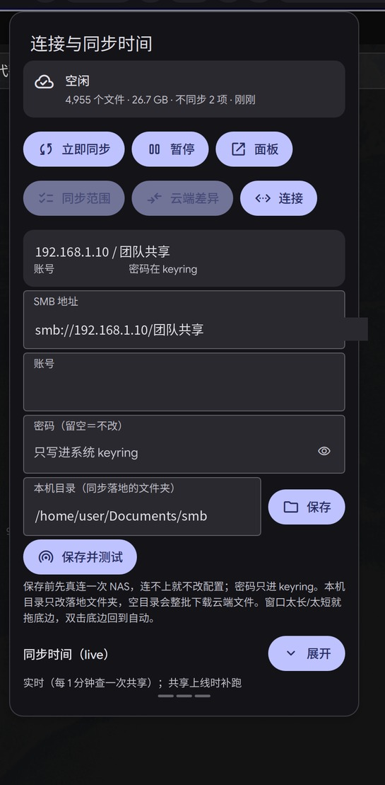

# dms-plugin-shuttle-scope

> 一个 DankMaterialShell 状态栏插件 + `shuttle-scope` 命令行工具：**哪些文件参与 Shuttle 的 NAS 双向同步**、**云端和本机差了什么**、**连哪台 NAS / 什么时候同步**，全在状态栏弹窗里点。



底层同步仍由 [Shuttle](https://github.com/DeedleFake/shuttle) 完成（SMB 2/3、用户级 systemd、不需要 root，也不用 `mount.cifs` / fstab）。这个项目只做「看得见、点得动」的那一层。

## 功能

| 视图 | 能做什么 |
|---|---|
| **同步范围** | 点目录名逐层进入任意深度，单个文件也能勾；勾选写进 Shuttle 的 `exclude`（支持 `待分类/代上传` 这种嵌套路径），改完约 1 秒热生效。取消勾选**不删文件**，两边副本都保留。 |
| **云端差异** | 只读视图：`仅云端` / `仅本地` / `不同`，专门找「本地删了、云端还在」的幽灵文件。目录行给整棵子树的聚合，点进去继续下钻。 |
| **连接** | 面板里直接改 **SMB 地址 / 账号 / 密码**、**本机目录**、**同步时间**（触发器 / 间隔 / 时刻 / 共享可用轮询）。保存前先真连一次 NAS，连不上就不改配置。 |

弹窗高度按内容自适应（收起时更短），拖底边三条横线可以自己定高度并记住，双击手柄回到自动高度。

## 依赖

- **DankMaterialShell** ≥ 1.2.0（Quickshell，`dms.service`）
- **[Shuttle](https://github.com/DeedleFake/shuttle)**，且已有一份能跑的配置（`~/.config/shuttle/config.toml` 里的 `[shares.*]` / `[profiles.*]` / `[shuttles.*]`）
- `smbclient`（Samba 客户端，用于测试连接与列共享）
- `secret-tool`（libsecret，密码只存系统 keyring）
- `python3` ≥ 3.11（`tomllib`）

## 安装

```bash
git clone https://github.com/chenshifanjian/dms-plugin-shuttle-scope.git
cd dms-plugin-shuttle-scope
bash scripts/install.sh      # 符号链接 + 清 QML 缓存 + 重启 dms
python3 tests/test_core.py   # 38 个纯函数单测，不联网、不碰真实配置
```

`install.sh` 全部用**符号链接**把 `plugin/*` 链到 `~/.config/DankMaterialShell/plugins/shuttleScope/`、把 `bin/shuttle-scope` 链到 `~/.local/bin/`，所以改仓库即改线上；旧实体文件会改名成 `.old-<时间戳>` 留着。

装完在 DMS 设置 → 状态栏里把 **「Shuttle 同步范围」** 加到右侧组件；等价的手改是在 `~/.config/DankMaterialShell/settings.json` 的**每个** `barConfigs[].rightWidgets` 里加一项：

```json
{ "id": "shuttleScope", "enabled": true }
```

## 命令行

QML 面板调的就是这些子命令，都一样可以单独用（输出为单行 JSON）：

```bash
shuttle-scope state                    # 状态 + 顶层范围 + 当前排除
shuttle-scope ls 待分类                 # 这一层有哪些项、是否同步、占多少
shuttle-scope toggle 待分类/代上传      # 勾 / 取消勾（嵌套路径）
shuttle-scope sizes --path 待分类       # 只统计这一层的直接子目录
shuttle-scope diff 待分类 --quick       # 用缓存比对（毫秒级）
shuttle-scope diff 待分类 --refresh     # 重扫 NAS（全共享约 15 秒 / 8.7k 文件）

shuttle-scope share show                # 连哪台 NAS、哪个共享、哪个账号
shuttle-scope share set --url smb://192.168.1.10/共享名 \
    --user 账号 --password-env SHUTTLE_SCOPE_PW      # 先测连；密码走环境变量，不进 argv

shuttle-scope schedule show
shuttle-scope schedule set --triggers realtime,schedule \
    --interval 6h --at "02:00,14:30" --poll 60s      # 空串＝删掉该项；triggers 空＝只手动

shuttle-scope local set --path /home/user/Documents/smb   # 改本机目录
```

## 差异是怎么算的

- **云端**：`smbclient -A <0600 临时 auth> -c 'recurse ON; prompt OFF; ls'` 递归列整个共享 → `~/.cache/shuttle-scope/remote.json`（TTL 600 s）。默认读缓存，`--refresh` 才重扫。
- **本地**：`os.walk` 同步根目录，跳过同步工具自己的元数据（`.shuttle-versions`、`.stfolder`、`Thumbs.db` …）。
- **判定**：只比文件大小。SMB 时间戳跨时区不可靠，读内容比 100 GB 级文件不可接受——这是刻意的取舍，代价是同名同尺寸但内容不同的文件看不出来。
- 目录行给整棵子树的差异聚合，按差异数降序。

## 安全

- 密码**只进系统 keyring**（`service=shuttle`，key 是完整 SMB URL），`config.toml` 里只有主机 / 共享 / 账号。
- 密码从 QML 到 Python 只走一条路：`connProc.environment` → `--password-env` → `os.environ.pop` → `secret-tool` 的 stdin，**不进 argv、不落文件**，用完即清环境变量。
- 写 keyring 前会去掉粘贴带进来的 `\r` / `\n`（否则测连通过、真挂载认证失败）。
- 临时 auth 文件 `chmod 600`，用完即删。仓库里没有任何口令。

## 已知限制

- 换地址/账号后，旧的 keyring 条目仍要手动清：`secret-tool clear service shuttle username '<旧 URL>'`。
- 换本机目录**不搬文件**：旧目录的文件留在原地，新目录若为空会整批从云端下载（面板会先给警告）。
- `exclude` 是前缀匹配，不支持「排父留子」。
- 面板打开时读的是缓存，可能过期；点「重扫云端」才碰 NAS。
- 差异只比大小（见上），需要内容级校验请另配 `rsync -c` 之类。

## 项目结构

```
bin/shuttle-scope            启动器（把 src/ 塞进 sys.path 后调 cli:main）
src/shuttle_scope/
  core.py                    路径、配置读取、体积格式化
  sizes.py                   本地体积统计 + sizes.json 缓存
  tree.py                    ls <rel> 逐层枚举
  remote.py                  smbclient 递归列共享 → remote.json（TTL 600s）
  diff.py                    本地 os.walk ⇄ 云端索引，按层聚合
  config.py                  改 exclude，备份 + 复核 + 失败回滚
  connect.py                 改连接 / 本机目录 / 同步时间（测连 → keyring → 写 TOML）
  cli.py                     子命令分发
plugin/                      DMS 插件三件套（plugin.json + Widget + Settings）
scripts/install.sh           符号链接 + 清 qmlcache + reset-failed + 重启 dms
tests/test_core.py           纯函数单测
docs/                        设计文档（密码通道、时间键语义、缓存策略、踩过的坑）
```

## 踩过的坑（写下来省下一个人两小时）

- `ColumnLayout` 放进 `DankFlickable` 后 `implicitHeight` **恒为 0**：`contentHeight` 必须用 `col.childrenRect.height`，否则内容超出既不滚动也不报错，静默裁掉底部。
- 弹窗可视区是 `flick.height = popoutHeight - headerHeight - detailsHeight`，所以量内容要把 chrome 加回去。
- `secret-tool store` 会把 stdin 的尾换行一起存进去（`abc123\n`），必须不带换行喂。
- 改用户手写的 TOML 要幂等：值没变就整行原样返回，否则第一次保存就把人的行尾注释洗掉。
- `Proc.runCommand` 有内置超时，十几秒的全扫会返回 `exit 124`，必须显式传超时。

## License

MIT
